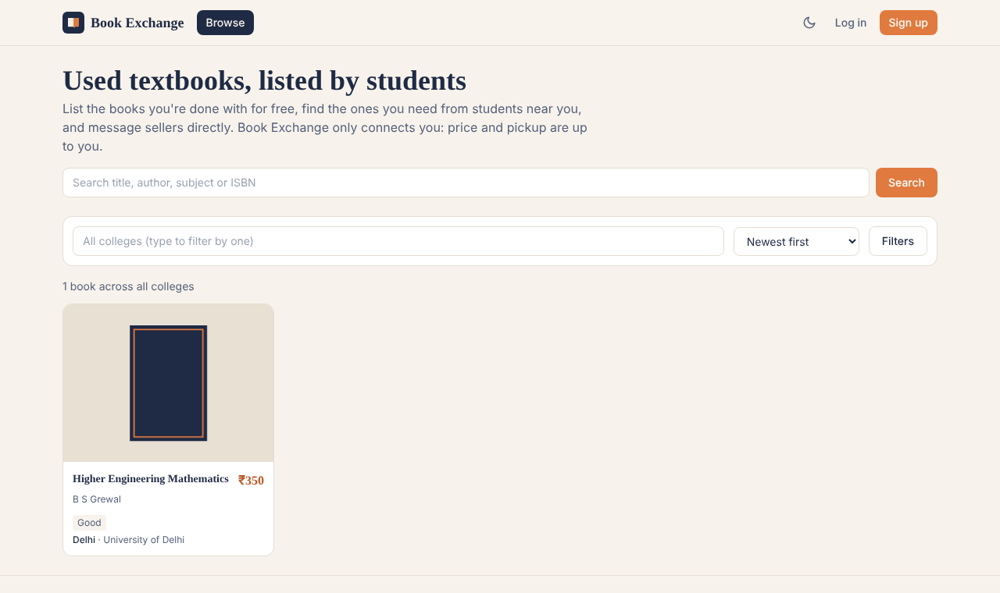
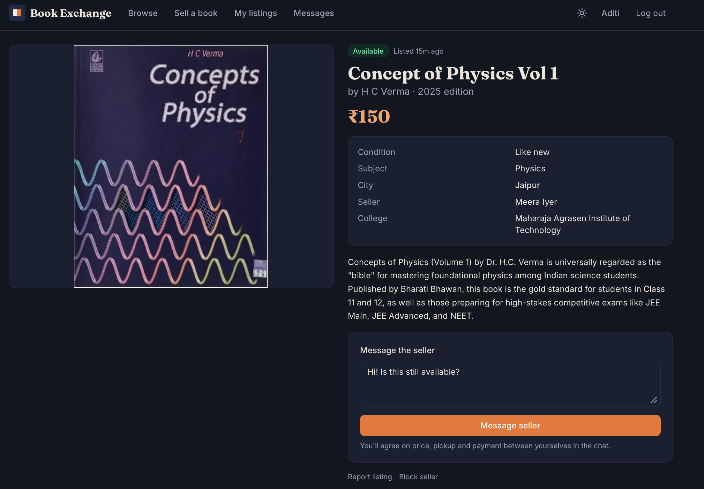
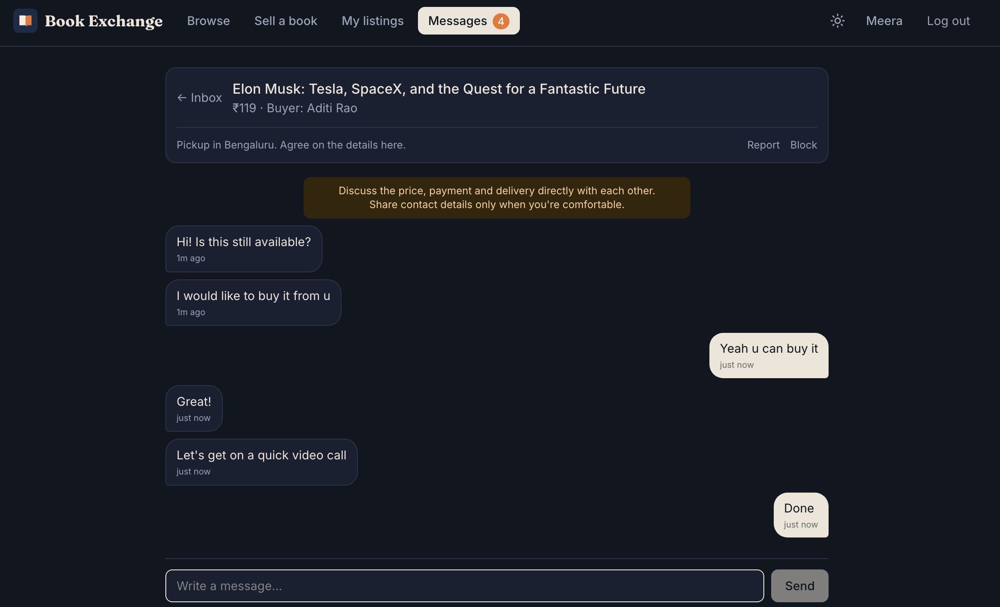
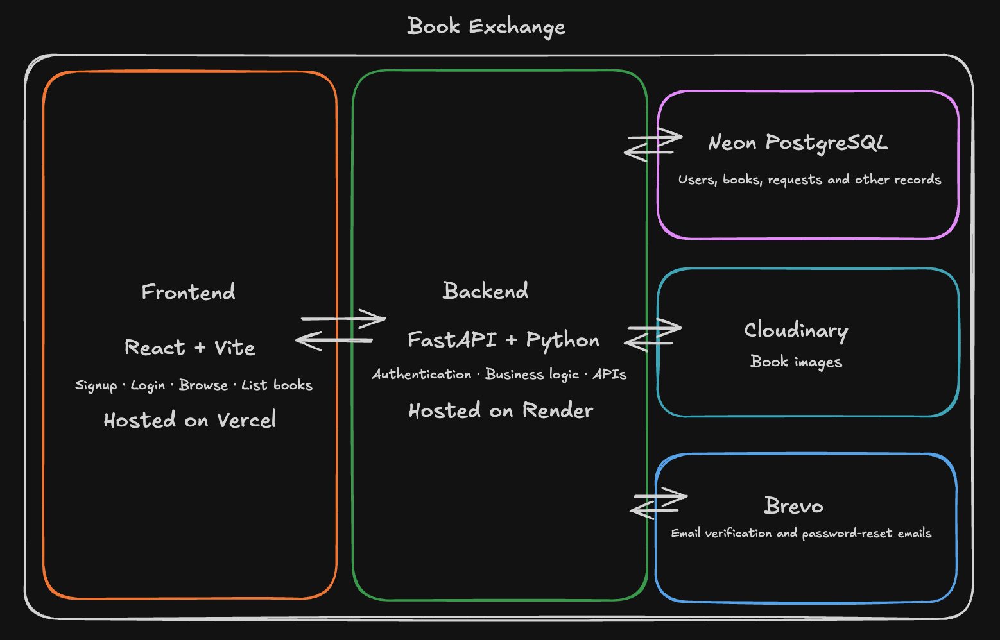

# Book Exchange

A student-to-student marketplace for buying and selling books. Whether it's a novel you've finished reading, a self-help book you no longer need, or an old textbook from your last semester, Book Exchange helps you find someone who'd love to read it next.

Students can list their books, discover listings by title, college or city, and connect directly with sellers through in-app messaging. Buyers and sellers handle pricing, payments and delivery arrangements themselves.

Give your books a second life instead of letting them gather dust on your shelves.



## Features

- **Accounts:** sign up with email verification (6-digit code), forgot/reset password, change password, delete account
- **Colleges:** search-as-you-type picker. "DU", "Delhi University" and "University of Delhi" all resolve to the same college, and new colleges can be added with a "did you mean…?" check to avoid duplicates
- **Listings:** title, author, price and pickup city (required), plus edition, subject, semester, condition, ISBN, description and up to 3 photos. Photos are resized and stripped of location data on upload. Sellers mark books sold, or available again
- **Browse:** search by title, author, subject or ISBN; filter by college, city, semester, condition and price; sort and paginate. Anyone can browse without an account
- **Messaging:** "Message seller" opens a chat about that book (messaging again reopens the same one), with an unread badge and new messages appearing without a refresh.
- **Safety:** report listings or users, block users (works both ways), and rate limits on login, new chats and messages
- **Dark mode:** follows the system setting, with a toggle in the top bar

<br>

<p>
  
</p>

<br>

<p>
  
</p>


## Tech stack

| Part | Tech |
|---|---|
| Frontend | React 19, Vite, React Router, Tailwind CSS |
| Backend | Python, FastAPI, SQLModel (SQLAlchemy + Pydantic), Alembic |
| Database | SQLite in development, PostgreSQL (Neon) in production |
| Auth | bcrypt password hashing, opaque session tokens stored as SHA-256 hashes |
| Files & email | Cloudinary for photos, Brevo for transactional email |
| Hosting | Render (API), Vercel (frontend), free tiers |
| Tests | pytest: 47 API tests, run against both SQLite and Postgres |

## How it fits together

```
React (Vercel)  ──HTTPS + Bearer token──▶  FastAPI (Render)  ──▶  PostgreSQL (Neon)
                                              │
                                              ├──▶ Cloudinary (photos)
                                              └──▶ Brevo (verification / reset emails)
```



The API is the only thing that talks to the database. Every write checks two things: who you are (session token → user) and whether you're allowed (only a book's seller can edit it, only the two people in a conversation can read it). The site deliberately stays out of the transaction itself: no payments, no deliveries, no deal tracking.

## Running it locally

Requires Python 3.11+ and Node.js 20+.

**Backend** (http://127.0.0.1:8000/docs)
```bash
cd backend
python3 -m venv .venv
source .venv/bin/activate
pip install -r requirements.txt
cp .env.example .env
uvicorn app.main:app --reload
```
Locally, emails aren't sent: verification and reset codes are printed in this terminal.

**Frontend** (http://localhost:5173)
```bash
cd frontend
npm install
cp .env.example .env
npm run dev
```

**Tests**
```bash
cd backend
pytest
```
To run them against Postgres, point `TEST_DATABASE_URL` at an empty database.

## Project structure

```
backend/
  app/
    main.py              app setup, CORS, routers
    models.py            database tables
    schemas.py           request/response shapes
    security.py          password hashing, sessions, auth dependencies
    routers/             auth, colleges, books, conversations (chat), safety
    college_matching.py  normalising and fuzzy-matching college names
    storage.py           photo processing; local folder or Cloudinary
    emailer.py           console (dev) or Brevo
    ratelimit.py, codes.py, blocking.py
  migrations/            Alembic migrations (run on startup)
  tests/
frontend/
  src/
    api.js               API client
    auth.jsx             auth context
    pages/               Browse, BookDetail, BookForm, MyListings, Messages, Account, auth pages
    components/          layout, book card, college picker, UI pieces
render.yaml              Render config
```

Changing a table means editing `models.py` and generating a migration:
```bash
cd backend
alembic revision --autogenerate -m "describe the change"
```

## Deployment

The whole stack runs on free tiers of Neon, Cloudinary, Brevo, Render and Vercel.

## What's next

- Ratings after a completed deal
- "Notify me" when a wanted book gets listed
- ISBN lookup to auto-fill title and author
- An admin view for reports and merging duplicate colleges
- Installable mobile app (PWA)
